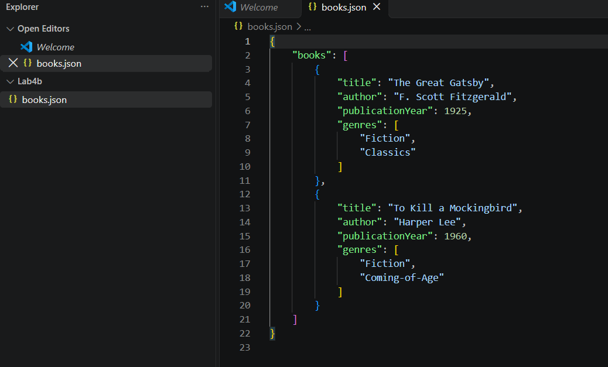
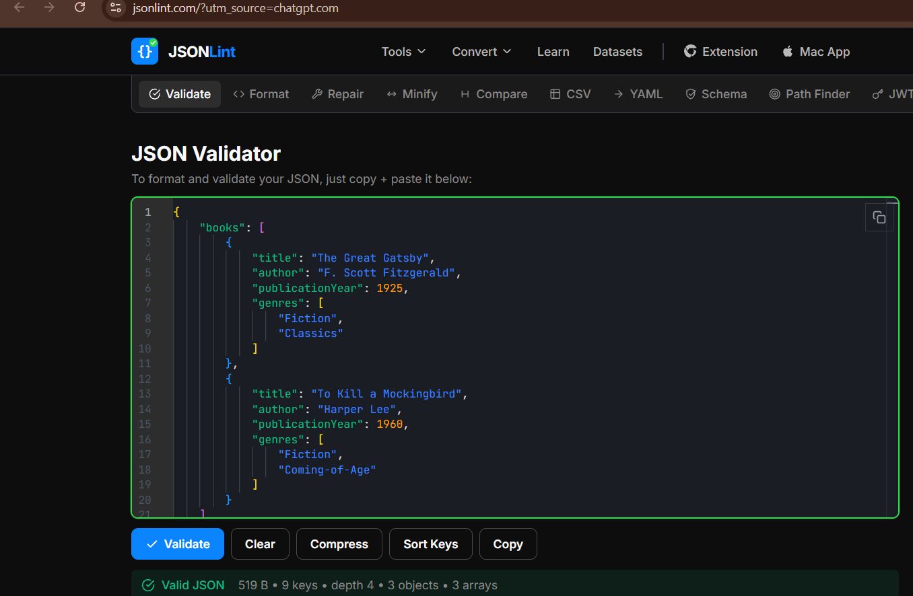
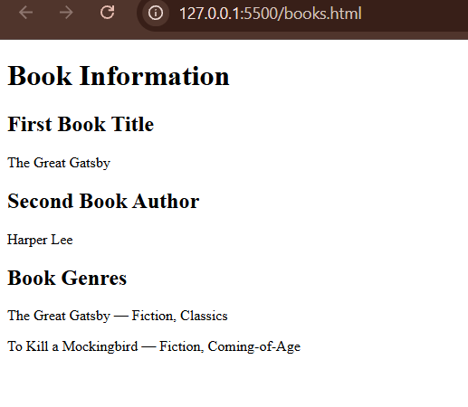
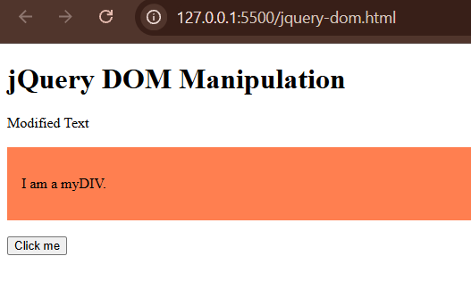
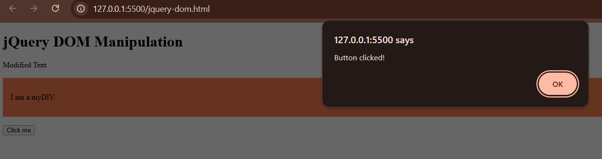

# BIC21203 Lab 4b - Client-Side Scripting (JSON and jQuery)

**Name:** Muhammad Hydher Hykal Bin Yahya

**Student ID:** AI240095

## Introduction

This repository contains the solutions for Lab 4b: Client-Side Scripting (JSON and jQuery) for BIC21203 Web Development.

The lab focuses on JSON data structures, retrieving JSON data using JavaScript fetch(), and DOM manipulation using jQuery.

## Questions

### Question 1 - Create and Structure JSON Data
Created a valid JSON file named books.json containing two book objects with their titles, authors, publication years and genres.

The following screenshots show the JSON file structure and successful validation.

**JSON File in Visual Studio Code**

**JSON Validation using JSONLint**

### Question 2 - Retrieve and Display JSON Data
Created books.html using the JavaScript fetch() API to retrieve data from books.json and display the required book information.

The screenshot below shows the book information successfully retrieved from books.json using the fetch() API.

### Question 3 - Compare Native JavaScript and jQuery
Created jquery-dom.html using jQuery 4.0.0 to modify text, add CSS classes and handle button click events.

**DOM Manipulation using jQuery**

**Button Click Event**

## How to Run

1. Download or clone this repository.
2. Open the project folder in Visual Studio Code.
3. Install or enable the Live Server extension.
4. Open books.html using Live Server to retrieve the JSON data.
5. Open jquery-dom.html using Live Server to test jQuery operations.
6. Make sure you have an internet connection for the jQuery CDN.

## Technologies Used

- HTML5
- JSON
- JavaScript
- jQuery 4.0.0
- Visual Studio Code
- Google Chrome
- Live Server

## Conclusion

This lab provided practical experience in working with JSON data and JavaScript. I learned how to structure JSON objects, retrieve and display data using fetch(), and perform DOM manipulation using jQuery methods.
